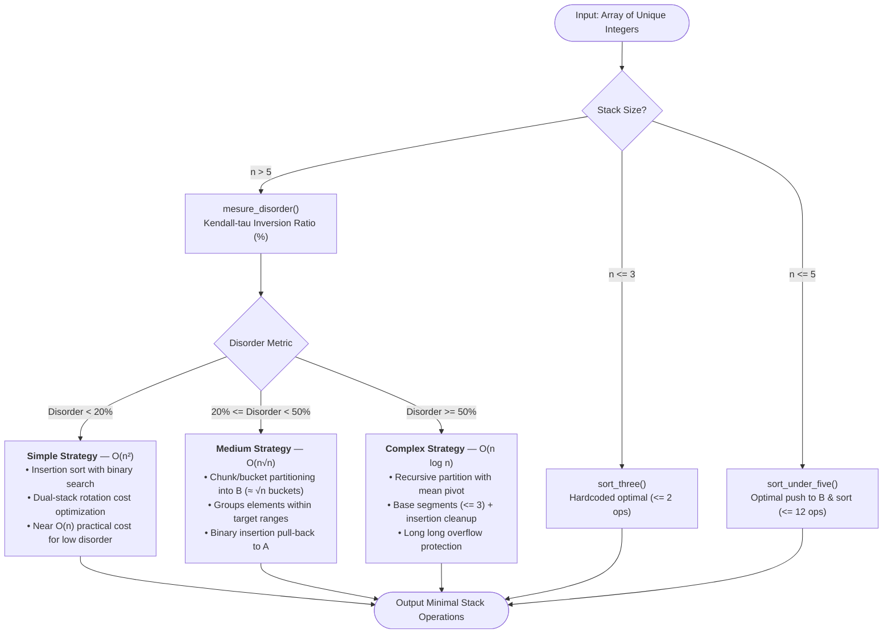

<div align="center">

*This project was created as part of the 42 curriculum by **igomes-d** and **mdurte-s**.*

# 🔄 push_swap

**An adaptive, high-performance integer sorting engine built on two stacks and a restricted set of operations.**

[](https://42.fr)
[](https://en.wikipedia.org/wiki/C_(programming_language))
[]()
[]()
[]()

<br>

[🎬 Visual Demo](#-visualizer-demo) •
[📖 Description](#-description) •
[⚡ Adaptive Architecture](#-adaptive-architecture) •
[📊 Performance](#-measured-performance--42-grading) •
[🛠️ Usage](#️-instructions--usage) •
[🧩 Bonus Checker](#-bonus--the-checker) •
[👥 Contributions](#-contributions)

</div>

---

## 🎬 Visualizer Demo

Experience `push_swap` sorting **500 random integers** (disorder: ~48%) in real time using our **Adaptive Engine**:

<p align="center">
  <video src="push_swap.mp4" controls width="100%" style="max-width: 850px; border-radius: 8px;">
    <source src="push_swap.mp4" type="video/mp4">
    Your browser does not support the video tag.
  </video>
</p>

> [!TIP]
> **Reproducing the Demo Locally:**
> The demo uses the interactive Python visualizer [`ft_ps_visu`](https://pypi.org/project/ft-ps-visu/):
> ```bash
> pip install ft_ps_visu
> python3 -m ft_ps_visu ./push_swap 500 48
> ```
> *(Arguments: `<binary>` `<element_count>` `<disorder_percent>`)*

---

## 📖 Description

`push_swap` receives a stack of unique integers and outputs the sequence of stack operations that sorts stack **A** in ascending order with the **minimum number of operations**.

There are only two stacks (**A** and **B**) and eleven allowed operations. The core challenge is not simply to sort, but to achieve **optimal operation counts** to meet strict 42 evaluation thresholds.

The project consists of two programs:
* **`push_swap` (Mandatory):** Calculates and prints the minimal operation sequence to stdout.
* **`checker` (Bonus):** Reads a list of integers and an operation stream from stdin, executes the operations, and outputs `OK` if stack A is sorted (and B is empty) or `KO` otherwise.

### The Adaptive Advantage
> [!NOTE]
> **No single sorting algorithm is optimal for every input distribution.**  
> A nearly-sorted list, a randomly shuffled list, and a reversed list each favor different strategies. Instead of forcing one algorithm on all inputs, `push_swap` calculates a mathematical **disorder metric** (Kendall-tau inversion ratio) and dynamically routes the dataset to the optimal algorithm.

---

### The Allowed Operations

| Category | Op | Description |
|:---|:---:|:---|
| **Push** | `pa` | Take the first element at the top of **B** and push it onto **A** |
| | `pb` | Take the first element at the top of **A** and push it onto **B** |
| **Swap** | `sa` | Swap the first 2 elements at the top of Stack **A** |
| | `sb` | Swap the first 2 elements at the top of Stack **B** |
| | `ss` | `sa` and `sb` simultaneously |
| **Rotate** | `ra` | Shift up all elements of Stack **A** by 1 (first element becomes the last) |
| | `rb` | Shift up all elements of Stack **B** by 1 (first element becomes the last) |
| | `rr` | `ra` and `rb` simultaneously |
| **Reverse Rotate** | `rra` | Shift down all elements of Stack **A** by 1 (last element becomes the first) |
| | `rrb` | Shift down all elements of Stack **B** by 1 (last element becomes the first) |
| | `rrr` | `rra` and `rrb` simultaneously |

---

## ⚡ Adaptive Architecture



### 1. Data Structure: Flat Ring Buffer (Circular Buffer)
Most implementations represent stacks with doubly-linked lists. We chose a **circular array buffer** (`t_node arr[]` with `start`, `len`, and `capacity` in [`includes/push_swap.h`](includes/push_swap.h)):

* **$O(1)$ Rotations:** Rotating is just incrementing/decrementing `start` index with modulo indexing via [`_i()`](srcs/stacks.c). No node pointers are unlinked or allocated.
* **$O(1)$ Cache-Friendly Pushes:** Contiguous memory layout maximizes CPU cache hit rates, crucial on large benchmarks (500+ items).
* **Random Access for Binary Search:** Enables instantaneous indexed lookups across stacks, allowing the *Simple* and *Medium* strategies to find optimal insertion points via binary search.

### 2. The Disorder Metric
Before selecting a strategy, [`mesure_disorder()`](srcs/algth_adaptive.c) counts inversions:

$$\text{Disorder} = \frac{\text{Number of pairs } (i, j) \text{ where } i < j \text{ and } a[i] > a[j]}{\frac{n(n - 1)}{2}} \times 100\%$$

* **0%** $\rightarrow$ Already sorted.
* **~50%** $\rightarrow$ Uniformly random distribution.
* **100%** $\rightarrow$ Completely reversed.

### 3. Strategies Breakdown

#### 🔹 Simple Strategy — $O(n^2)$ (Insertion-based)
*Implementation: [`srcs/algth_simple.c`](srcs/algth_simple.c)*
* Rotates the minimum to position, sweeps A to push disorder elements to B.
* Re-inserts elements into A using **binary search** ([`binary_find_fit_distance()`](srcs/algth_simple.c)) with the **cheapest combination of simultaneous dual rotations** ([`move_to_top_dual()`](srcs/algth_helpers.c)).
* **When used:** Disorder $< 20\%$. In practice, nearly-sorted input runs in **near-linear** time (~2,000 ops for 500 reversed/nearly-sorted numbers).

#### 🔹 Medium Strategy — $O(n\sqrt{n})$ (Bucket Distribution)
*Implementation: [`srcs/algth_medium.c`](srcs/algth_medium.c)*
* Splits the value range into $\approx \sqrt{n}$ buckets (`ft_sqrt(n)`).
* Iterates through stack A and pushes elements into their corresponding bucket in stack B, rotating B to group elements.
* Pulls elements back into A via binary insertion.
* **When used:** Moderate disorder ($20\% - 50\%$). Balances bucket count against elements per bucket.

#### 🔹 Complex Strategy — $O(n \log n)$ (Partial Quicksort)
*Implementation: [`srcs/algth_complex.c`](srcs/algth_complex.c)*
* Recursive partition sort using the **arithmetic mean** as pivot ([`get_avg()`](srcs/algth_complex_helpers.c)).
* Recursion terminates when segment size $\le 3$ ([`sort_three_a()`](srcs/algth_complex_helpers.c)), followed by an insertion cleanup.
* **Overflow safety:** Pivot accumulator sums up to $n$ integers that can reach `INT_MAX`, accumulated in `long long` to prevent signed overflow.
* **When used:** High disorder ($\ge 50\%$). Divides problems in half each recursive level.

---

## 📊 Measured Performance & 42 Grading

To obtain the maximum score (100% + bonus) under 42 criteria:
* **100 numbers:** $< 700$ operations for 5/5 points ($< 1500$ for minimum pass).
* **500 numbers:** $< 5500$ operations for 5/5 points ($< 11500$ for minimum pass).

### Average Operations on Random Input (Lower is Better)

| Stack Size ($n$) | Simple ($O(n^2)$) | Medium ($O(n\sqrt{n})$) | Complex ($O(n \log n)$) | **Adaptive Engine** | 42 5/5 Threshold | Status |
|:---:|:---:|:---:|:---:|:---:|:---:|:---:|
| **100** | ~368 | ~546 | ~620 | **~528** | `< 700` | **PASS (5/5)** |
| **500** | ~2,773 | ~3,815 | ~5,013 | **~3,932** | `< 5,500` | **PASS (5/5)** |

> [!NOTE]
> Lists of size $\le 3$ sort in $\le 2$ operations. Lists of size $\le 5$ sort in $\le 12$ operations.

---

## 🛠️ Instructions & Usage

### Requirements
* A C compiler (`gcc`, `clang`, or `cc`)
* GNU `make`

### Compilation

```bash
make          # Build mandatory push_swap -> ./push_swap
make bonus    # Build bonus checker       -> ./checker
make clean    # Remove intermediate object files
make fclean   # Remove objects and binaries
make re       # Clean rebuild
```

### Execution

Pass integers as individual arguments or as a single formatted string:

```bash
# Individual arguments
./push_swap 3 2 1

# Quoted string
./push_swap "4 67 3 87 23"

# Generating 500 random numbers
./push_swap $(shuf -i 1-100000 -n 500 | tr '\n' ' ')
```

### Execution Flags & Diagnostics

Force specific algorithms or inspect runtime telemetry with custom flags:

```bash
./push_swap --simple   <nums>   # Force O(n^2) Simple strategy
./push_swap --medium   <nums>   # Force O(n√n) Medium strategy
./push_swap --complex  <nums>   # Force O(n log n) Complex strategy
./push_swap --adaptive <nums>   # Explicit Adaptive mode (default)
./push_swap --bench    <nums>   # Print disorder %, strategy and op counts to stderr
```

Example benchmark report (printed to `stderr`):
```text
[bench] disorder: 49.87%
[bench] strategy: Adaptive / O(n log n)
[bench] total_ops: 3897
[bench] sa: 0 sb: 0 ss: 0 pa: 498 pb: 500 ra: 1240 rb: 110 rr: 85 rra: 720 rrb: 310 rrr: 334
```

### Automated Testing Script (`test.sh`)

Use the bundled test suite to validate runs with customizable element count, disorder cap, and flags:

```bash
./test.sh -n 100 -d 50         # Test 100 numbers with up to 50% disorder
./test.sh -n 500 -d 100        # Test 500 numbers with 100% disorder
./test.sh -n 500 -f "--simple" # Force a specific strategy
```

---

## 🧩 Bonus — The Checker

The `checker` program validates whether a sequence of operations correctly sorts the stack:

```bash
# Pipe push_swap output directly into checker
./push_swap 3 2 1 | ./checker 3 2 1
# Output: OK

# Invalid or incomplete sequence
echo -e "sa\nra" | ./checker 3 2 1
# Output: KO
```

> [!IMPORTANT]
> The bonus `checker` ([`bonus/checker_bonus.c`](bonus/checker_bonus.c)) is deliberately implemented using a **doubly-linked list** rather than the circular buffer of `push_swap`. This dual-architecture design ensured that solver and checker were validated independently without shared assumptions.

---

## 📁 Project Structure

```text
├── push_swap.mp4             # Full 1080p visualizer demo video
├── test.sh                   # Automated test & benchmark runner
├── Makefile                  # Build targets (all, bonus, clean, fclean, re)
├── assets/
│   ├── push_swap_demo.gif    # Animated demo preview
│   └── demo_preview.png      # High-resolution visualizer snapshot
├── includes/
│   └── push_swap.h           # Ring-buffer structures (t_ctx, t_stk) & prototypes
├── srcs/
│   ├── main.c                # Entry point & small-N bypasses
│   ├── main_helpers.c        # Context initialization & benchmark printing
│   ├── parser_argv*.c        # Input validation & duplicate detection
│   ├── stacks.c              # Ring buffer engine & modulo index translation
│   ├── op_*.c                # 11 stack operations with benchmark counters
│   ├── algth_adaptive.c      # Disorder measurement & strategy router
│   ├── algth_simple.c        # Simple strategy O(n²)
│   ├── algth_medium.c        # Medium bucket strategy O(n√n)
│   ├── algth_complex*.c      # Complex quicksort strategy O(n log n)
│   ├── algth_helpers.c       # Dual-stack move optimization helpers
│   └── mini_libft.c          # In-house standard library helpers
└── bonus/
    ├── checker_bonus.c       # Linked-list checker entry point & stdin loop
    └── *_bonus.c             # Linked-list stack operations & parser
```

---

## 👥 Contributions

This project was built collaboratively as a two-person team:

### **mdurte-s**
* Core architecture and entry point (`main.c`), argument parsing, and input validation (`parser_argv*.c`).
* Implementation of the eleven stack operations (`op_push`, `op_swap`, `op_rotate`, `op_rev_rotate`).
* The Complex / partial-quicksort algorithm (`algth_complex.c`).
* In-house `ft_printf` formatting utilities and core header prototypes.
* The bonus **checker** engine and linked-list operations.

### **igomes-d**
* Adaptive engine and Kendall-tau disorder calculation (`algth_adaptive.c`).
* The Simple and Medium sorting strategies (`algth_simple.c`, `algth_medium.c`) and dual-rotation helpers (`algth_helpers.c`).
* The circular-buffer stack data structure (`stacks.c`) and context/benchmark subsystem (`main_helpers.c`).
* Utilities (`mini_libft`, `ft_split`) and bonus init/parsing routines.
* Final integration, `--bench` telemetry, and edge-case fixes (e.g. `long long` accumulator overflow protection).

---

## 📚 Resources

### References
* **42 push_swap subject** — Official project specification.
* **Sorting Algorithm Complexity** — Theoretical analysis of Insertion Sort, Bucket Sort, and Quicksort:
  * [Wikipedia: Sorting Algorithms](https://en.wikipedia.org/wiki/Sorting_algorithm)
  * [GeeksforGeeks: Insertion Sort](https://www.geeksforgeeks.org/dsa/insertion-sort-algorithm/)
  * [Wikipedia: Greedy Algorithms](https://en.wikipedia.org/wiki/Greedy_algorithm)
  * [Wikipedia: Bucket Sort](https://en.wikipedia.org/wiki/Bucket_sort)
  * [Wikipedia: Quicksort](https://pt.wikipedia.org/wiki/Quicksort)
  * [Wikipedia: Introsort](https://en.wikipedia.org/wiki/Introsort)
* **Kendall-tau & Inversion Count** — Basis for the Adaptive engine disorder metric:
  * [Wikipedia: Kendall tau Distance](https://en.wikipedia.org/wiki/Kendall_tau_distance)
* **Ring Buffer Data Structure** — Data structure behind our $O(1)$ rotations:
  * [Wikipedia: Circular Buffer](https://en.wikipedia.org/wiki/Circular_buffer)

### Use of AI Disclosure
An AI assistant was consulted as an educational and review aid for:
* Deepening understanding of complexity boundaries ($O(n^2)$, $O(n\sqrt{n})$, $O(n \log n)$) and operation-cost modeling for combined moves (`rr`, `rrr`).
* Clarifying edge-case risks (e.g. integer-overflow in accumulator logic and checker cleanup).

All algorithmic implementations, data structure designs, and final code were authored directly by the team.
